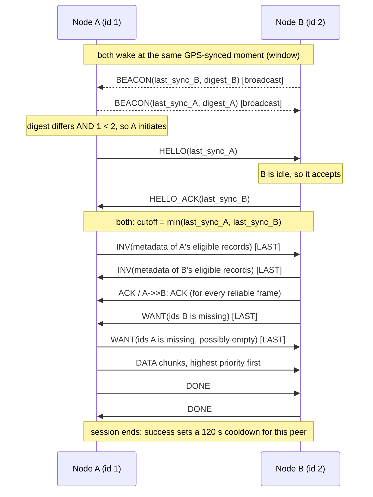

# trailmesh documentation

This folder documents how the code actually behaves, file by file, so the team
can check it against the design in issue #2. Each file doc covers its public
API, its control flow, the core logic, the assumptions it makes, and its known
gaps.

**Start here, then read in this order:**

| Doc | Source | What it owns |
|---|---|---|
| [records.md](records.md) | `trailmesh/records.py` | How the app's rows are carried: kinds, encoding, ids |
| [store.md](store.md) | `trailmesh/store.py` | The link to the app's database: cutoff, tombstones, digest |
| [wire.md](wire.md) | `trailmesh/wire.py` | Byte layout of every frame on the air |
| [reliable.md](reliable.md) | `trailmesh/reliable.py` | ACKs, retransmission, in-order delivery |
| [session.md](session.md) | `trailmesh/session.py` | One exchange between two devices |
| [node.md](node.md) | `trailmesh/node.py` | Duty cycle, discovery, choosing who to talk to |
| [link.md](link.md) | `trailmesh/link.py` | The radio interface (ESP-NOW and LoRa) |
| [espnow_serial.md](espnow_serial.md) | `trailmesh/espnow_serial.py` | Python side of the USB link to the ESP32 |
| [firmware.md](firmware.md) | `firmware/espnow_bridge/espnow_bridge.ino` | ESP32 side: radio bridge and partner filter |
| [lora.md](lora.md) | `firmware/heltec_bridge/`, `trailmesh/heltec_serial.py`, `lora.py`, `radio.py` | Heltec V3 (LoRa + ESP-NOW): firmware, the 60 m switch, radio modes |
| [sim.md](sim.md) | `trailmesh/sim.py` | The fake radio used by tests |
| [tests.md](tests.md) | `tests/` | What each test proves, and what it does not |

## Architecture in one picture

```
 Your app (UI, server sync)
        |  writes to its Database; node.poll(); on_record / on_delivered callbacks
        v
 +-------------- Python (trailmesh) ------------------------------+
 | Node      duty cycle, beacons, picks a peer, owns 1 Session    |
 |  Session  HELLO -> INV -> WANT -> DATA -> DONE                 |
 |   ReliableSender / ReliableReceiver   seq, ACK, retransmit     |
 | AppStore  wraps the app's Database: export / merge / purge     |
 | wire.Frame            12-byte header + payload                 |
 +---------------------------------------------------------------+
        |  Link interface: send / poll / set_radio / set_partner
        v
 EspNowSerialLink --USB serial (SLIP)--> ESP32 espnow_bridge --ESP-NOW--> other ESP32s
 SimLink (tests)  --in-memory medium--> other SimLinks
```

The ESP32 holds **no protocol logic**. It moves frames between the radio and
USB and drops frames that aren't from the current partner. Everything else,
including all state, runs in Python on the host computer.

## One encounter, end to end

Hiker A (device id 1) holds a new water report. Hiker B (device id 2) does not.



The beacon sends and the two INV streams happen independently and can
interleave. The diagram shows one possible order.

## Vocabulary

- **device id**: the app's `device_id` (8 hex digits). On the air it's the
  nonzero u32 `mesh_id`. Both the "lower id initiates" rule and the firmware
  filter use it.
- **record**: one row of one of the app's shared tables (locale comment,
  message, geolocation or tombstone). Its id is derived from the row's identity,
  `(origin_id, seq)`.
- **tombstone**: a record that kills a message everywhere it reaches. The
  receiver's app creates a `delivered` one; the server can create others.
- **frame**: one radio packet, at most `min(link.mtu, 250)` bytes. A record
  bigger than one frame is split into chunks across many frames.
- **window**: the short, scheduled time when every device's radio is on for discovery.
- **session**: one exchange with one peer, from HELLO to DONE or failure.
- **last_server_sync**: when this device last synced with the server (the app's `device_info`).
- **cutoff**: `min(my last_server_sync, peer's last_server_sync)`. Only records
  created or received after it are exchanged.
- **relay**: for a given message, any device that is neither its sender nor its receiver.

## Checklist: confirm these match your mental model

Each item links to the doc that explains it.

1. **No LoRa trigger yet.** Issue #2 says LoRa contact turns ESP-NOW on. Here,
   ESP-NOW runs its own scheduled discovery windows. ([node.md](node.md))
2. **No transmit/listen slot patterns.** Random beacon times inside a shared
   window replace them. ([node.md](node.md))
3. **Handshake byte order is reversed from the issue.** The issue says
   `[HANDSHAKE_COMMAND][DEVICE_ID]`. Here every frame, the handshake included,
   is `[DEVICE_ID][TYPE]...`, so the firmware can filter all frames the same
   way. ([wire.md](wire.md))
4. **The cutoff is the older of the two last server syncs**, and a record is
   exchanged if it was created **or received** after it, so data picked up
   offline still spreads. ([store.md](store.md))
5. **The app's database is the only store.** The mesh moves the app's rows and
   leaves the rules to the app's `merge()`/`export()`/`purge()`, except the two
   mesh rules in 4 and 6. ([store.md](store.md))
6. **Relays delete tombstoned messages** but keep relaying the tombstone. Only
   the sender and receiver keep the message, marked dead. ([store.md](store.md))
7. **Only the lower device id starts a session**, and a device in a session
   ignores everyone else. ([node.md](node.md))
8. **The exchange is symmetric.** Both sides send INV, WANT and DATA. There is
   no client/server role after the handshake. ([session.md](session.md))
9. **ACKs are TCP-like**, but the timeout is fixed (no RTT estimation) and every
   reliable frame gets its own ACK. ([reliable.md](reliable.md))
10. **Server sync is not implemented here.** The app's `last_server_sync`
    must be updated after each server sync. ([store.md](store.md))
11. **Time sync is not implemented here.** The `clock` you pass to `Node` must
    already be GPS- or phone-synced. ([node.md](node.md))
12. **Messages and tombstones expire after 31 days** (the app's rule). The
    sender and receiver keep their messages for good.
    ([store.md](store.md))

## Known gaps across files

Each one is detailed in its file's doc.

- A device that refuses some kinds (`accept_kinds`) never matches its peer's
  digest, so it re-syncs with that peer every time the cooldown expires.
  ([node.md](node.md))
- There is no authentication: a peer can claim any sender, or tombstone anyone's
  message. ([records.md](records.md))
- The firmware has never been compiled. ([firmware.md](firmware.md))
