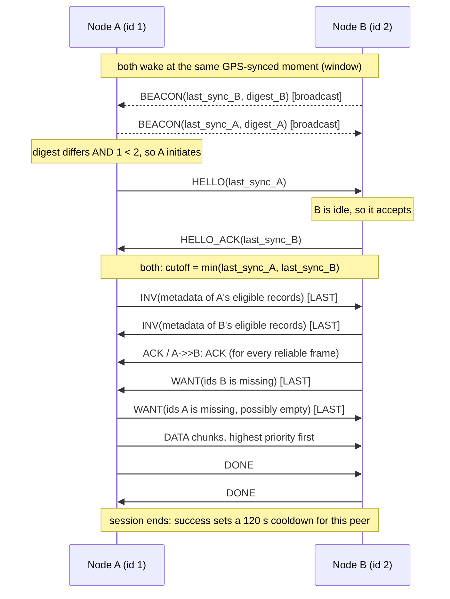

# trailmesh documentation

This folder documents how the code actually behaves, file by file, so the team
can check it against the design in issue #2. Each file doc covers its public
API, its control flow, the core logic, the assumptions it makes, and its known
gaps.

**Start here, then read in this order:**

| Doc | Source | What it owns |
|---|---|---|
| [records.md](records.md) | `trailmesh/records.py` | What a piece of data is, and how its id is computed |
| [store.md](store.md) | `trailmesh/store.py` | Persistence, the cutoff rule, overrides, the digest |
| [wire.md](wire.md) | `trailmesh/wire.py` | Byte layout of every frame on the air |
| [reliable.md](reliable.md) | `trailmesh/reliable.py` | ACKs, retransmission, in-order delivery |
| [session.md](session.md) | `trailmesh/session.py` | One exchange between two devices |
| [node.md](node.md) | `trailmesh/node.py` | Duty cycle, discovery, choosing who to talk to |
| [link.md](link.md) | `trailmesh/link.py` | The radio interface (ESP-NOW now, LoRa later) |
| [espnow_serial.md](espnow_serial.md) | `trailmesh/espnow_serial.py` | Python side of the USB link to the ESP32 |
| [firmware.md](firmware.md) | `firmware/espnow_bridge/espnow_bridge.ino` | ESP32 side: radio bridge and partner filter |
| [sim.md](sim.md) | `trailmesh/sim.py` | The fake radio used by tests |
| [tests.md](tests.md) | `tests/` | What each test proves, and what it does not |

## Architecture in one picture

```
 Your app (UI, server sync)
        |  node.post(record), on_record callback, node.poll()
        v
 +-------------- Python (trailmesh) ------------------------------+
 | Node      duty cycle, beacons, picks a peer, owns 1 Session    |
 |  Session  HELLO -> INV -> WANT -> DATA -> DONE                 |
 |   ReliableSender / ReliableReceiver   seq, ACK, retransmit     |
 | RecordStore (SQLite)   records, tombstones, last_server_sync   |
 | wire.Frame            12-byte header + payload                 |
 +---------------------------------------------------------------+
        |  Link interface: send / poll / set_radio / set_partner
        v
 EspNowSerialLink --USB serial (SLIP)--> ESP32 espnow_bridge --ESP-NOW--> other ESP32s
 SimLink (tests)  --in-memory medium--> other SimLinks
```

The ESP32 holds **no protocol logic**. It moves frames between the radio and
USB and drops frames that aren't from the current partner. Everything else,
including all state, runs in Python on the host computer.

## One encounter, end to end

Hiker A (device id 1) holds a new water report. Hiker B (device id 2) does not.



The beacon sends and the two INV streams happen independently and can
interleave. The diagram shows one possible order.

## Vocabulary

- **device id**: a nonzero 32-bit number per device, unique per user. The app
  chooses it. Both the "lower id initiates" rule and the firmware filter use it.
- **record**: one immutable piece of data (locale update, message or
  pin). Its id is a hash of its contents.
- **frame**: one radio packet, at most `link.mtu` bytes (250 for ESP-NOW).
- **window**: the short, scheduled time when every device's radio is on for discovery.
- **session**: one exchange with one peer, from HELLO to DONE or failure.
- **last_server_sync**: when this device last downloaded from the server.
- **server_time**: on a record, when the server first saw that record (0 = never).
- **cutoff**: `min(my last_server_sync, peer's last_server_sync)`.

## Checklist: confirm these match your mental model

Each item links to the doc that explains it.

1. **No LoRa trigger yet.** Issue #2 says LoRa contact turns ESP-NOW on. Here,
   ESP-NOW runs its own scheduled discovery windows. ([node.md](node.md))
2. **No transmit/listen slot patterns.** Random beacon times inside a shared
   window replace them. ([node.md](node.md))
3. **Handshake byte order is reversed from the issue.** The issue says
   `[HANDSHAKE_COMMAND][DEVICE_ID]`. Here every frame, the handshake included,
   is `[DEVICE_ID][TYPE]...`, so the firmware can filter all frames the same
   way. ([wire.md](wire.md))
4. **The cutoff uses the record's `server_time`, not its creation time.** This
   is a deliberate change from the issue's wording. ([store.md](store.md))
5. **Overrides apply only to records with a "supersede key".** Today that means
   only locale updates (`locale:field`). Messages and pins are never replaced.
   ([records.md](records.md), [store.md](store.md))
6. **Replaced data is discarded, not archived.** The issue left this as an open
   question. The code keeps only the id of the replaced record (a "tombstone"),
   not its content. ([store.md](store.md))
7. **Only the lower device id starts a session**, and a device in a session
   ignores everyone else. ([node.md](node.md))
8. **The exchange is symmetric.** Both sides send INV, WANT and DATA. There is
   no client/server role after the handshake. ([session.md](session.md))
9. **ACKs are TCP-like**, but the timeout is fixed (no RTT estimation) and every
   reliable frame gets its own ACK. ([reliable.md](reliable.md))
10. **Server sync is not implemented here.** The code assumes the server stamps
    `server_time` on records, and that the app sets `store.last_server_sync`
    after each download. ([store.md](store.md))
11. **Time sync is not implemented here.** The `clock` you pass to `Node` must
    already be GPS- or phone-synced. ([node.md](node.md))
12. **No expiry.** Records and tombstones are never deleted.
    ([store.md](store.md))

## Known gaps across files

Each one is detailed in its file's doc.

- A malformed DATA payload can raise an exception out of `Node.poll()`, which
  would stop the main loop. ([session.md](session.md))
- A device that refuses some kinds (`accept_kinds`) never matches its peer's
  digest, so it re-syncs with that peer every time the cooldown expires.
  ([node.md](node.md))
- There is no authentication: a peer can claim any `server_time` or author id.
  ([records.md](records.md))
- The firmware has never been compiled. ([firmware.md](firmware.md))
