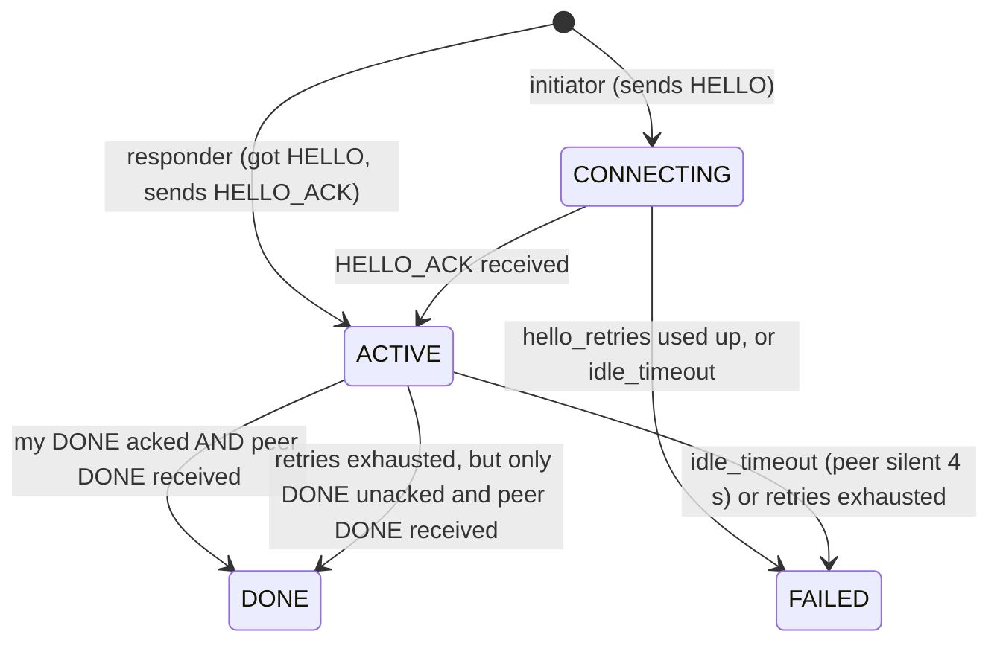

# session.py: one exchange between two devices

**Purpose.** Implements "Data exchange on contact" from issue #2: agree on a
cutoff, swap metadata, request what's missing, transfer it, finish. The Node
creates one `Session` per encounter (see [node.md](node.md)).

**Design style: sans-IO.** The session never reads the clock or touches the
radio. The Node passes in the time (`now`) and incoming frames, and the session
sends through a `send(frame)` callback. That keeps it link-agnostic and lets
tests drive it with a virtual clock.

## State machine



`finished` means DONE or FAILED. `ok` means DONE.

## Constructor

```python
Session(my_id, peer_id, session_id, initiator, store, config, mtu, send, now,
        peer_sync=None, on_record=None)
```

- **Initiator:** state `CONNECTING`, sends HELLO right away.
- **Responder:** state `ACTIVE`, sends HELLO_ACK and immediately queues its INV.
  `peer_sync` (the initiator's last server sync, from its HELLO) is needed to
  compute the cutoff.

## The protocol steps

Both sides run the **same** steps after the handshake. There is no client or server.

### Step 1: cutoff and INV (`_activate`)
```
cutoff  = min(my last_server_sync, peer's last_server_sync)
entries = store.inventory(cutoff)     # (id, kind, created), see store.md
queue INV frames, 18 entries each; the last frame has FLAG_LAST
(no entries: one empty INV with FLAG_LAST)
```
This runs on HELLO_ACK for the initiator, and in the constructor for the responder.

### Step 2: on the peer's complete INV, send WANT
INV entries are accumulated across frames. When the frame with FLAG_LAST arrives:
```
wants = [id for (id, kind, _) in peer_inv
         if kind in config.accept_kinds and not store.has(id)]
remember wants as _wanted     # DATA is accepted only for these ids
queue WANT frames, 29 ids each, FLAG_LAST on the last one (possibly empty)
```
`store.has` includes tombstones, so records we already replaced are never requested.

### Step 3: on the peer's complete WANT, send DATA, then DONE
```
records = [store.get(id) for id in peer_wants], skipping ids we no longer have
sort by (PRIORITY[kind], newest first)
for each record: split encode() into 226-byte chunks, send DATA(id, i, count, chunk)
    (skipped if it would need more than 65 535 chunks)
then send DONE
```
The session uses `mtu = min(link.mtu, 250)`, so every frame it builds (INV,
WANT, DATA) fits in one ESP-NOW packet: 12 B header + 12 B DATA header +
226 B chunk = 250 B.

This is a **lazy generator**. Frames are created only as the send window frees
up, so a large record doesn't fill memory with queued frames.

### Step 4: receiving DATA
```
ignore unless record_id is in _wanted
ignore if index >= count, or count differs from this record's first chunk
store chunk[index]
when all `count` chunks are present:
    record = Record.decode(chunks 0..count-1 joined)   # malformed: drop it
    if record.id != record_id: drop it                 # integrity check
    if store.put(record): count it and call on_record(record)
```
The reliable layer already delivers DATA frames in order with nothing missing
or duplicated. The chunk index and count are a second check that also covers a
buggy or hostile peer. Because the id is a hash of the contents, a record is
either stored complete and byte-identical or not at all.

Each record is stored **as soon as its last chunk arrives**, not at the end of
the session. Records that only partially arrived are discarded when the session
ends, and the next session resends them from the first chunk.

### Step 5: finishing
- Receiving the peer's DONE sets `peer_done`.
- In `tick`: if `peer_done` **and** our DONE has been queued **and** everything
  we sent is acked, the session is DONE.

## Why ordering is safe

Each side's reliable stream is delivered in order (see [reliable.md](reliable.md)), and each side sends:

```
INV ...(LAST)  ->  WANT ...(LAST)  ->  DATA ... DONE
```

- WANT is only queued after the peer's complete INV arrives.
- DATA is only generated after the peer's complete WANT arrives. The peer sends
  that WANT after its own INV, so our WANT is always queued before our DATA starts.

## Inbound frame handling (`on_frame`)

Every frame routed to the session updates `last_heard` first, then:

| Frame | Behaviour |
|---|---|
| HELLO | Responder re-sends HELLO_ACK (the first one was lost). Initiator ignores it. |
| HELLO_ACK | Only in CONNECTING: becomes ACTIVE and runs Step 1 |
| anything while CONNECTING | Ignored. The peer will retransmit after we go ACTIVE. |
| ACK | `sender.on_ack` |
| INV / WANT / DATA / DONE | Pass to the receiver, deliver whatever is in order (only if not finished), **always send an ACK** |

## Timers (`tick`, called on every `Node.poll`)

In this order:
1. If finished: do nothing.
2. If silent for more than `idle_timeout` (4 s): FAILED. This is the "walked out of range" case.
3. If CONNECTING: re-send HELLO every `hello_interval` (0.3 s). After
   `hello_retries` (10) attempts: FAILED.
4. If ACTIVE: retransmit overdue frames. On `RetriesExhausted`: DONE if only our
   DONE is unacked and `peer_done`, otherwise FAILED.
5. Pump: send queued INV/WANT frames first, then DATA from the generator,
   while the window has room.
6. If the completion condition holds: DONE.

**The two-generals edge case (step 4).** The last frame either side sends is
the ACK for the other's DONE. If that ACK is lost, one side keeps
retransmitting DONE to a peer that has already finished. Two things cover it:
- The Node keeps finished sessions "lingering" for 3 s and still ACKs their
  frames ([node.md](node.md)).
- If even that fails, "only DONE unacked + peer DONE received" counts as
  success, because every DATA frame was already confirmed.

## Counters

- `records_received`: records that arrived complete and were new to the store.
- `records_sent`: records whose last chunk was **queued**, not necessarily acked.

## Assumptions

- **One session per peer pair at a time.** The Node enforces this.
- **Records requested in WANT stay available until sent.** If one is replaced
  mid-session, it's skipped silently. The peer still ends correctly, because
  DONE follows.
- The INV lists **every** eligible record, even ones the peer clearly has.
  There's no smarter set reconciliation. This is fine for a few thousand
  records (18 per frame).

## Known gaps

- **No resume within a record.** If a session drops at chunk 4 000 of 4 425,
  the next session starts that record again from chunk 0.
- **There's no maximum session length.** If the peer stays in range, a huge record
  keeps the radio on until it finishes.
- **`records_sent` counts queued records,** so it can overstate what the peer
  actually received in a failed session.
